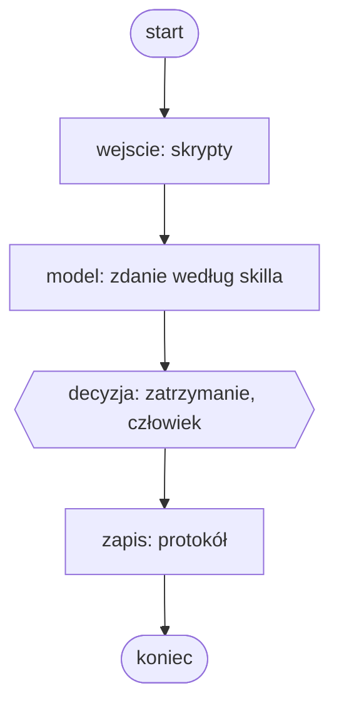

# Agent LangGraph: Jedno zagadnienie

Jeden wspólny, prosty graf dla zagadnień, których nie obejmują trzy agenty z własnym grafem. Uruchamia się go z nazwą zagadnienia, czyli nazwą jego skilla. Graf uruchamia skrypty wskazane przez skill, przekazuje ich wynik modelowi razem ze skillem jako instrukcją, zatrzymuje się na decyzję człowieka i dopiero po niej zapisuje protokół.

- Zagadnienia: 3, P2, P3, P5, P6, R1–R18
- Kod: `agenci_langgraph/jedno_zagadnienie.py`
- Zagadnienia 3, P2, P3 i P6 wymagają działającej aplikacji

## Polecenia

| Nr | Zagadnienie | Polecenie | Skrypty w kroku `wejscie` | Aplikacja |
| --- | --- | --- | --- | --- |
| 3 | Ocena asercji | `ocena-asercji` | `tabela_asercji.py`, `wymaganie.py reset-hasla` | tak |
| P2 | Ponowny test po poprawce | `test-potwierdzajacy` | `przebieg.py --port <port> --test <test>` | tak |
| P3 | Test niestabilny | `test-niestabilny` | `historia.py --port <port>` | tak |
| P5 | Karta sesji eksploracyjnej | `sesja-eksploracyjna` | `wymaganie.py reset-hasla` | – |
| P6 | Przegląd zmiany w testach | `przeglad-zmiany-w-testach` | `zmiana_w_testach.py`, `wymaganie.py reset-hasla` | tak |
| R1 | Przypadki testowe techniką | `projektowanie-przypadkow` | `wymaganie.py reset-hasla`, `wymaganie.py filtr-zamowien` | – |
| R2 | Zgłoszenie z obserwacji ręcznej | `zgloszenie-z-obserwacji` | `wymaganie.py reset-hasla` | – |
| R3 | Kandydaci do automatyzacji | `kandydaci-do-automatyzacji` | `lista_sprawdzen.py`, `lista_testow.py` | – |
| R4 | Szkic testu automatycznego | `szkic-testu-automatycznego` | `wymaganie.py reset-hasla`, `lista_testow.py` | – |
| R5 | Testy niefunkcjonalne | `testy-niefunkcjonalne` | `wymaganie.py reset-hasla`, `wymaganie.py filtr-zamowien` | – |
| R6 | Testy po zmianie wymagania | `testy-po-zmianie-wymagania` | `zmiana_wymagania.py` | – |
| R7 | Testy z opisu interfejsu | `testy-z-opisu-interfejsu` | `opis_interfejsu.py`, `wymaganie.py reset-hasla` | – |
| R8 | Plan testów iteracji | `plan-testow-iteracji` | `plan_iteracji.py`, z opcją `--zmiana-wymagania` także `zmiana_wymagania.py` | – |
| R9 | Wiedza o produkcie z bazy wiedzy | `wiedza-o-produkcie` | `wiedza.py "<pytanie>"`, z opcją `--wymaganie` także `wymaganie.py` | – |
| R10 | Podobne zgłoszenia przed założeniem nowego | `podobne-zgloszenia` | `podobne_zgloszenia.py "<opis>"`, `wymaganie.py reset-hasla` | – |
| R11 | Przegląd przypadków testowych ręcznych | `przeglad-przypadkow-recznych` | `przypadki_reczne.py`, `wymaganie.py reset-hasla` | – |
| R12 | Przebieg interfejsu w Playwright | `przebieg-ui` | `przebieg_ui.py --port <port>`, `wymaganie.py reset-hasla` | tak |
| R13 | Przebieg wywołań API | `przebieg-api` | `przebieg_api.py --port <port>`, `opis_interfejsu.py`, `wymaganie.py reset-hasla` | tak |
| R14 | Wiadomość przychodząca | `wiadomosc-przychodzaca` | `wiadomosc.py --port <port> --email <adres>`, `wymaganie.py reset-hasla` | tak |
| R15 | PDF wygenerowany przez system | `pdf-potwierdzenie` | `pdf.py --port <port>`, `wymaganie.py reset-hasla` | tak |
| R16 | Dostępność strony | `dostepnosc-strony` | `dostepnosc.py --port <port>`, `wymaganie.py reset-hasla` | tak |
| R17 | Lokalizatory po zmianie strony | `lokalizatory-po-zmianie` | `lokalizatory.py`, `wymaganie.py reset-hasla` | – |
| R18 | Raport z jednego przebiegu | `raport-z-przebiegu` | `przebieg.py --port <port>` | tak |

Wszystkie skrypty leżą w katalogu `narzedzia`. Listę poleceń razem z trzema pozostałymi agentami wypisuje `python -m agenci_langgraph lista`.

## Uruchomienie

Wcześniej ustaw model: [agenci-langgraph-model.md](agenci-langgraph-model.md). Dla zagadnień 3, P2, P3 i P6 uruchom aplikację w pierwszym oknie PowerShell:

```powershell
python app/serwer.py
```

W drugim oknie PowerShell, z katalogu głównego repozytorium:

```powershell
python -m agenci_langgraph ocena-asercji
python -m agenci_langgraph test-potwierdzajacy --port <port builda z poprawką> --test <nazwa testu ze zgłoszenia> --plik material/zgloszenia/ZGL-101.md
python -m agenci_langgraph test-niestabilny --port 8765
python -m agenci_langgraph sesja-eksploracyjna --prosba "karta sesji przed sesją" --plik material/sesja/ryzyka.md
python -m agenci_langgraph sesja-eksploracyjna --prosba "raport po sesji" --plik material/sesja/notatki-z-sesji.md
python -m agenci_langgraph przeglad-zmiany-w-testach
python -m agenci_langgraph projektowanie-przypadkow
python -m agenci_langgraph zgloszenie-z-obserwacji --prosba "<której obserwacji dotyczy zgłoszenie>" --plik material/sesja/notatki-z-sesji.md --plik material/zgloszenia/otwarte.json
python -m agenci_langgraph kandydaci-do-automatyzacji
python -m agenci_langgraph szkic-testu-automatycznego --prosba "<potwierdzony przypadek: kroki, dane, oczekiwany wynik>" --plik testy/conftest.py
python -m agenci_langgraph testy-niefunkcjonalne
python -m agenci_langgraph testy-po-zmianie-wymagania --plik testy/conftest.py
python -m agenci_langgraph testy-z-opisu-interfejsu
python -m agenci_langgraph plan-testow-iteracji
python -m agenci_langgraph wiedza-o-produkcie --pytanie "Czy po zmianie hasła klient zostaje zalogowany?" --wymaganie reset-hasla
python -m agenci_langgraph podobne-zgloszenia --opis "Ten sam link resetu ustawia hasło drugi raz"
python -m agenci_langgraph przeglad-przypadkow-recznych
```

## Parametry od człowieka

To, co skill każe wziąć z prośby testera, graf przyjmuje z wiersza poleceń. Opcje danego polecenia pokazuje `python -m agenci_langgraph <polecenie> --help`.

| Opcja | Polecenia | Znaczenie |
| --- | --- | --- |
| `--prosba "<tekst>"` | wszystkie | prośba człowieka; model dostaje ją jako zadanie przed wejściem, na przykład tryb karty sesji, wskazaną obserwację albo potwierdzony przypadek |
| `--plik <ścieżka>` | wszystkie | plik, który człowiek dokłada do wejścia; opcję można powtórzyć |
| `--port <port>` | `test-potwierdzajacy` (wymagana), `test-niestabilny` (domyślnie 8765) | port builda |
| `--test <nazwa>` | `test-potwierdzajacy` (wymagana) | test ze zgłoszenia; opcję można powtórzyć |
| `--powtorzenia <liczba>` | `test-niestabilny` | liczba uruchomień zestawu, jeśli inna niż w skrypcie |
| `--porty <port> <port>` | `ocena-asercji`, `przeglad-zmiany-w-testach` | porty buildów, jeśli inne niż w skrypcie |
| `--zmiana-wymagania` | `plan-testow-iteracji` | dokłada do wejścia `narzedzia/zmiana_wymagania.py` |
| `--pytanie "<tekst>"` | `wiedza-o-produkcie` (wymagana) | pytanie testera do bazy wiedzy |
| `--wymaganie <nazwa>` | `wiedza-o-produkcie` | wymaganie dołożone do wejścia, na przykład `reset-hasla` |
| `--opis "<tekst>"` | `podobne-zgloszenia` (wymagana) | opis zachowania, które tester chce zgłosić |
| `--email <adres>` | `wiadomosc-przychodzaca` | adres skrzynki; domyślnie `anna@example.com` |

Niektóre skille wymieniają jako wejście plik, dla którego nie ma skryptu: zgłoszenie, listę ryzyk, notatki z sesji, listę otwartych zgłoszeń, kod testów. Model w grafie nie czyta plików, więc taki plik wskazuje człowiek opcją `--plik`. Lista poleceń podaje przy każdym zagadnieniu pliki, które wymienia jego skill. Graf nie przyjmuje pliku z katalogu `prowadzacy` i kończy się wtedy komunikatem „Agent zatrzymany: agent nie czyta katalogu prowadzacy”. Brakujący plik też zatrzymuje agenta, zanim zapyta model.

Bez wymaganego parametru (port i test przy ponownym teście) polecenie kończy się błędem wiersza poleceń, zanim cokolwiek uruchomi. Gdy człowiek nie poda prośby ani pliku, o które prosi skill, model dostaje tylko wynik skryptów i powinien napisać, czego mu brakuje.

## Graf



| Krok | Kto | Co się dzieje |
| --- | --- | --- |
| `wejscie` | skrypty | skrypty z tabeli poleceń, z parametrami od człowieka |
| `model` | model, skill zagadnienia | zdanie w formacie ze skilla; wejściem jest wynik skryptów, a także prośba i pliki od człowieka |
| `decyzja` | człowiek | zatrzymanie: pytania z części „Decyzja człowieka” w zdaniu modelu |
| `zapis` | graf | zapis protokołu |

## Co dostaje model

Instrukcją jest cały plik `.github/skills/<polecenie>/SKILL.md`, poprzedzony krótką ramą wspólną dla wszystkich agentów. Wejście to tekst oddany przez skrypty, w kolejności z tabeli, a za nim pliki wskazane przez człowieka, każdy oznaczony jako „plik wskazany przez człowieka”. Prośba stoi na początku jako zadanie. Decyzja człowieka do modelu nie trafia: model jest pytany raz, przed zatrzymaniem.

## Co zapisuje

| Plik | Zawartość |
| --- | --- |
| `wyniki/agenci/<polecenie>.md` | protokół: prośba i pliki od człowieka, polecenia skryptów, zdanie modelu jako cytat i decyzja człowieka |

Skrypty zapisują przy okazji swoje pliki w katalogu `wyniki`, tak samo jak przy uruchomieniu ręcznym.

## Czego agent nie robi

- Nie zapisuje niczego przed decyzją człowieka i nie zapisuje niczego poza protokołem.
- Nie zapisuje kodu testu i nie uruchamia go po przyjęciu (zagadnienie R4). Kod zaproponowany przez model zostaje w protokole, a zapis do katalogu `testy` i przebieg robi człowiek.
- Nie zmienia testów, zgłoszeń, list ani planów i niczego nie wysyła.
- Nie ponawia przebiegów i nie uruchamia skryptów spoza listy zagadnienia.
- Nie czyta plików, których człowiek nie wskazał, ani plików z katalogu `prowadzacy`.
