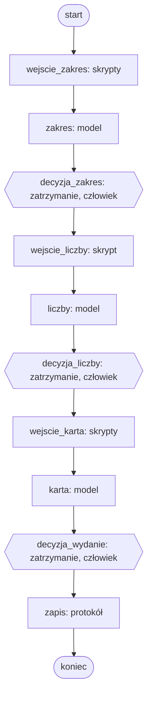

# Agent LangGraph: Dwa buildy i karta

Trzy części jednego grafu: zakres po zmianie, zdanie o dwóch buildach w liczbach i karta przed wgraniem. Po każdej części graf zatrzymuje się na decyzję człowieka. Zdania modelu i decyzje z wcześniejszych części zostają w stanie grafu, a przy ostatnim zatrzymaniu człowiek widzi swoje wcześniejsze decyzje obok karty.

- Zagadnienia: 4 (zakres po zmianie), 5 (zdanie o dwóch buildach), 6 (karta przed wgraniem)
- Kod: `agenci_langgraph/dwa_buildy_i_karta.py`
- Trzecia część grafu wymaga działającej aplikacji

## Uruchomienie

Pierwsze okno PowerShell:

```powershell
python app/serwer.py
```

Drugie okno PowerShell:

```powershell
python -m agenci_langgraph karta
```

Wcześniej ustaw model: [agenci-langgraph-model.md](agenci-langgraph-model.md).

## Graf



| Krok | Kto | Co się dzieje |
| --- | --- | --- |
| `wejscie_zakres` | skrypty | `python narzedzia/lista_sprawdzen.py`, `python narzedzia/wymaganie.py reset-hasla` |
| `zakres` | model, skill `zakres-po-zmianie` | kolejność sprawdzeń od najwyższego ryzyka i to, co nie mieści się w oknie |
| `decyzja_zakres` | człowiek | pierwsze zatrzymanie: co wykonać w oknie, czy okno wydłużyć, czy przyjąć ryzyko pominięcia |
| `wejscie_liczby` | skrypt | `python narzedzia/liczby.py` |
| `liczby` | model, skill `dwa-buildy-w-liczbach` | jedno zdanie o zmianie w liczbach między buildami, progi bez zmian |
| `decyzja_liczby` | człowiek | drugie zatrzymanie: czy zmiana blokuje wydanie, czy powstaje zgłoszenie, czy potrzebna jest diagnoza |
| `wejscie_karta` | skrypty | `python narzedzia/przebieg.py --port 8765`, `python narzedzia/przebieg.py --port 8766`, `python narzedzia/zbierz_wyniki.py --porty 8765 8766` |
| `karta` | model, skill `karta-przed-wgraniem` | jedno zdanie i karta: co sprawdzone, co czerwone, czego nie ruszano |
| `decyzja_wydanie` | człowiek | trzecie zatrzymanie: decyzja o wydaniu |
| `zapis` | graf | zapis protokołu |

## Decyzja człowieka

Przy każdym zatrzymaniu graf pokazuje zdanie modelu z danej części i pytania z jego części „Decyzja człowieka”. Odpowiedź jest dowolnym tekstem.

Przy trzecim zatrzymaniu graf wypisuje najpierw decyzje z dwóch wcześniejszych części, wzięte ze stanu grafu, a pod nimi kartę:

```text
WCZEŚNIEJSZE DECYZJE CZŁOWIEKA (ze stanu grafu)
- [zakres] Co wykonać w oknie: <odpowiedź z pierwszego zatrzymania>
- [liczby] Czy ta zmiana blokuje wydanie: <odpowiedź z drugiego zatrzymania>

ZDANIE MODELU (krok karta, skill karta-przed-wgraniem)
```

Decyzję o wydaniu wpisuje osoba, która za nie odpowiada. Karta modelu tej decyzji nie zawiera i jej nie podpowiada; pilnuje tego skill `karta-przed-wgraniem`.

## Co dostaje model

Każdy krok modelu dostaje tylko wynik skryptów ze swojej części. Krok `karta` dostaje jeden zbiór ze skryptu `zbierz_wyniki.py`: zapisane przebiegi obu buildów, liczby, otwarte zgłoszenia oraz zakres planowany i wykonany. Wcześniejsze zdania modelu i decyzje człowieka do modelu nie trafiają. Widzi je tylko człowiek przy ostatnim zatrzymaniu i w protokole.

Skrypt `zbierz_wyniki.py` bierze przebiegi z plików, które zapisuje `przebieg.py`, dlatego krok `wejscie_karta` uruchamia najpierw przebieg na obu buildach. Każdy przebieg jest wykonywany raz.

## Co zapisuje

| Plik | Zawartość |
| --- | --- |
| `wyniki/agenci/dwa-buildy-i-karta.md` | protokół: zdanie modelu i decyzje człowieka z trzech części |

Skrypty zapisują przy okazji swoje pliki w katalogu `wyniki`, w tym `wyniki/zbior-wynikow.txt`.

## Czego agent nie robi

- Nie podejmuje decyzji o wydaniu i niczego nie wdraża.
- Nie usuwa pozycji z listy sprawdzeń i nie zmienia progów.
- Nie przekazuje modelowi decyzji człowieka z wcześniejszych części.
- Nie ponawia przebiegów.
