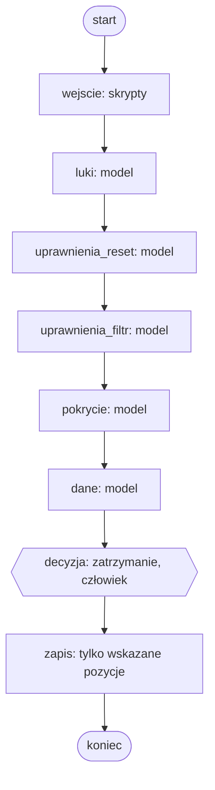

# Agent LangGraph: Od wymagania do potwierdzonego zestawu

Model czyta wymaganie i mówi swoje zdanie w pięciu krokach. Graf zatrzymuje się raz, przed zapisem. Do potwierdzonego zestawu trafiają wyłącznie pozycje, których numery człowiek wpisał przy zatrzymaniu.

- Zagadnienia: 1 (luki w wymaganiu), 8 (uprawnienia przy zwykłej historyjce), P4 (pokrycie wymagania testami), 7 (dane pod regułę)
- Kod: `agenci_langgraph/od_wymagania_do_zestawu.py`
- Aplikacja nie jest potrzebna

## Uruchomienie

```powershell
python -m agenci_langgraph zestaw
```

Wcześniej ustaw model: [agenci-langgraph-model.md](agenci-langgraph-model.md).

## Graf



| Krok | Kto | Co się dzieje |
| --- | --- | --- |
| `wejscie` | skrypty | `python narzedzia/wymaganie.py reset-hasla`, `python narzedzia/wymaganie.py filtr-zamowien`, `python narzedzia/lista_testow.py` |
| `luki` | model, skill `luki-w-wymaganiu` | pytania do autora i dopisane przypadki dla wymagania resetu hasła |
| `uprawnienia_reset` | model, skill `przypadki-uprawnien` | przypadki uprawnień dla historyjki o resecie hasła |
| `uprawnienia_filtr` | model, skill `przypadki-uprawnien` | przypadki uprawnień dla historyjki o filtrze zamówień |
| `pokrycie` | model, skill `pokrycie-wymagania` | zdania wymagania zestawione z listą testów |
| `dane` | model, skill `dane-pod-regule` | tabela wejść i plik dla przebiegu |
| `decyzja` | człowiek | zatrzymanie: człowiek widzi pięć zdań modelu i odpowiada na decyzje z każdego |
| `zapis` | graf | zapis pozycji wskazanych przez człowieka i protokołu |

Każdy krok modelu dostaje tylko to wejście, którego potrzebuje jego skill. Krok `dane` dostaje dodatkowo jedno zdanie zadania: tester nie wskazał jednej reguły, więc dane mają dotyczyć reguł operacji z formatu pliku dla przebiegu.

## Decyzja człowieka

Przy zatrzymaniu graf pokazuje po kolei zdanie modelu z każdego kroku i pod nim pytania z części „Decyzja człowieka” tego zdania, na przykład o to, które dopisane przypadki wchodzą do zestawu testów i które wejścia trafiają do przebiegu.

Pozycje wskazuje się numerami z pierwszej kolumny tabel modelu, na przykład:

```text
  Które dopisane przypadki wchodzą do zestawu testów: M1, M3
```

Zasady wyboru:

- Liczą się tylko numery wpisane wprost. Graf nie rozwija zakresów: „M1-M3” oznacza dla niego dwa numery, M1 i M3.
- Odpowiedź bez numerów, na przykład „wszystkie” albo „żadnego”, jest zapisywana dosłownie, ale żadnej pozycji do zestawu nie dodaje.
- Sam Enter oznacza brak odpowiedzi. Nic wtedy nie wchodzi.
- Numer, którego nie ma w tabelach zdania modelu, jest wypisany jako nieznaleziony.

Graf wybiera wiersze po numerze i przepisuje je dosłownie. Treści wierszy nie ocenia i nie zmienia.

## Co zapisuje

| Plik | Zawartość |
| --- | --- |
| `wyniki/agenci/zestaw-potwierdzony.md` | dla każdego pytania odpowiedź człowieka i wiersze o wskazanych numerach; pozycji niewskazanych nie ma |
| `wyniki/agenci/dane-potwierdzone.json` | plik dla przebiegu tylko ze wskazanymi wejściami; powstaje, gdy człowiek wskazał numery w kroku `dane` i model oddał poprawny blok JSON |
| `wyniki/agenci/od-wymagania-do-zestawu.md` | protokół: pełne zdanie modelu z każdego kroku i wszystkie decyzje |

Wejścia w pliku dla przebiegu zostają w kolejności, w jakiej podał je model. Plik ma format opisany w `docs/narzedzie-przebieg-danych.md`. Przebiegu agent nie uruchamia. Robi to człowiek:

```powershell
python narzedzia/przebieg_danych.py --port 8766 --dane wyniki/agenci/dane-potwierdzone.json
```

Agent nie zmienia plików w katalogu `testy`. Potwierdzony zestaw jest listą pozycji, z której tester albo inny agent może napisać testy.

## Czego agent nie robi

- Nie dodaje do zestawu niczego, czego człowiek nie wskazał.
- Nie odpowiada na pytania do autora wymagania i nie uzupełnia brakującej polityki.
- Nie uruchamia przebiegu na danych.
- Nie pyta modelu ponownie po decyzji człowieka.
