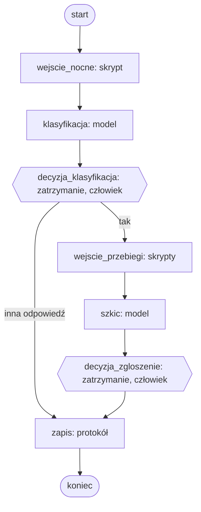

# Agent LangGraph: Od czerwonego przebiegu do zgłoszenia

Model najpierw rozbiera zapisany nocny przebieg na grupy awarii. Człowiek klasyfikuje grupy i decyduje, czy graf ma iść dalej. Dopiero po słowie „tak” graf uruchamia testy na dwóch buildach i prosi model o szkic zgłoszenia. O samym zgłoszeniu znowu decyduje człowiek.

- Zagadnienia: P1 (czerwony przebieg: produkt, test czy środowisko), 2 (defekt z czerwonego przebiegu)
- Kod: `agenci_langgraph/od_przebiegu_do_zgloszenia.py`
- Druga część grafu wymaga działającej aplikacji

## Uruchomienie

Pierwsze okno PowerShell:

```powershell
python app/serwer.py
```

Drugie okno PowerShell:

```powershell
python -m agenci_langgraph zgloszenie
```

| Opcja | Znaczenie |
| --- | --- |
| `--port` | port builda, z którego przebiegu ma powstać szkic zgłoszenia; domyślnie 8766 |
| `--port-odniesienia` | port builda do porównania; domyślnie 8765 |

Wcześniej ustaw model: [agenci-langgraph-model.md](agenci-langgraph-model.md).

## Graf



| Krok | Kto | Co się dzieje |
| --- | --- | --- |
| `wejscie_nocne` | skrypt | `python narzedzia/przebieg_nocny.py`: zapisany nocny przebieg, przebieg referencyjny i log |
| `klasyfikacja` | model, skill `klasyfikacja-awarii` | grupy awarii z proponowaną klasyfikacją i dowodem |
| `decyzja_klasyfikacja` | człowiek | pierwsze zatrzymanie: klasyfikacja i następny krok dla każdej grupy oraz pytanie grafu o szkic zgłoszenia |
| `wejscie_przebiegi` | skrypty | `python narzedzia/przebieg.py --port 8766`, `python narzedzia/przebieg.py --port 8765`, `python narzedzia/wymaganie.py reset-hasla` |
| `szkic` | model, skill `zgloszenie-defektu` | szkic zgłoszenia opisujący zachowanie systemu |
| `decyzja_zgloszenie` | człowiek | drugie zatrzymanie: czy to defekt, dotkliwość, priorytet, czy zgłoszenie wychodzi |
| `zapis` | graf | zapis protokołu |

## Decyzja człowieka

Pierwsze zatrzymanie ma dwie części. Najpierw człowiek odpowiada na pytania z części „Decyzja człowieka” w zdaniu modelu: jaka jest klasyfikacja każdej grupy i co dalej. Potem graf zadaje własne pytanie:

```text
  Czy graf ma uruchomić testy na buildach pod portami 8766 i 8765 i poprosić model o szkic zgłoszenia (tak albo nie): _
```

Graf idzie do szkicu tylko wtedy, gdy odpowiedź zaczyna się od słowa „tak”. Każda inna odpowiedź, także brak odpowiedzi, kończy przebieg zapisem protokołu: testy nie są uruchamiane, a model nie jest pytany drugi raz. O tym, czy z czerwonego przebiegu ma powstać zgłoszenie, nie decyduje więc ani model, ani graf.

Przy drugim zatrzymaniu człowiek odpowiada na pytania ze szkicu. Model dotkliwości ani priorytetu nie nadaje; wpisuje je człowiek.

## Co dostaje model

Krok `klasyfikacja` dostaje wynik skryptu `przebieg_nocny.py`. Krok `szkic` dostaje wyniki dwóch przebiegów i wymaganie. Klasyfikacja wpisana przez człowieka do modelu nie trafia: szkic powstaje wyłącznie z wejścia przygotowanego przez skrypty.

## Co zapisuje

| Plik | Zawartość |
| --- | --- |
| `wyniki/agenci/od-przebiegu-do-zgloszenia.md` | protokół: klasyfikacja modelu i decyzje człowieka, odpowiedź na pytanie o szkic, a po drodze „tak” także szkic zgłoszenia i decyzje o nim |

Skrypt `przebieg.py` zapisuje przy okazji swoje pliki `wyniki/przebieg-<port>.txt` i `wyniki/przebieg-<port>.json`.

## Czego agent nie robi

- Nie wysyła zgłoszenia i nie zakłada go w żadnym systemie. Szkic zostaje w protokole.
- Nie ponawia przebiegu ani pojedynczych testów.
- Nie uruchamia testów bez zgody człowieka.
- Nie klasyfikuje awarii i nie nadaje dotkliwości ani priorytetu.
